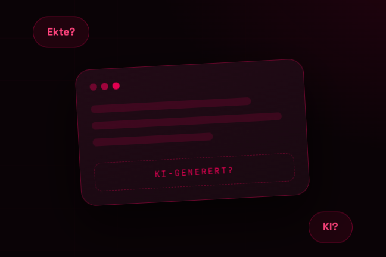

# Refleksjon — KI-Ishiki Podcast

## Innledning

I gruppa er vi tre programmerere, og hver av oss lager sin egen nettside. Jeg hadde ansvar for min egen — fra start til slutt. Nettsiden formidler temaet KI til ungdom: fakta, statistikk, podkastepisoden, quiz og visuell stil.

## Hva jeg gjorde

- Planla strukturen: hjem, fakta, episode, deltakere, temaer, quiz, kilder.
- Valgte visuell stil: vinrød og svart palett, fontene Space Grotesk og JetBrains Mono.
- Skrev HTML, CSS og JavaScript for hele nettsiden.
- Laget responsivt design for PC, nettbrett og mobil.
- Samlet statistikk fra Udir, Medietilsynet og OECD og satte det inn i kort.
- Laget en quiz med 6 spørsmål og poengsystem.
- Sjekket alle lenker manuelt og testet siden i Chrome DevTools.

## Utfordringer

- Gjøre siden kort, men med fullt innhold — kuttet ned til seks blokker.
- Quizen fungerte først med feil — testet hvert spørsmål for seg.
- Mobilversjonen — brukte media queries.

## Om KI

Jeg prøvde GitHub Copilot litt for å se hvordan autofullføring fungerer. Alt jeg tok derfra, skrev jeg om til mitt eget.

Jeg brukte også KI til å lage den animerte delen helt i starten av siden — de flyvende boblene «Ekte?» og «KI?», og ticker-baren i nyhetsstil som beveger seg nedover siden. Koden derfra tilpasset jeg også til min egen stil og sjekket at alt fungerte som det skulle.

Alt annet — tekster, design, research, tester — gjorde jeg selv.

## Hva jeg ville gjort annerledes

- Testet på mobil fra første dag.
- Laget en plan med tydelige delmål underveis.

## Oppsummering

Jeg har lært å bygge en nettside fra bunnen av, og forstått at design og tekst må jobbe sammen. Det viktigste er å forstå koden man skriver.

**Publisering:** nettsiden skulle publiseres på skolens portal, men den fungerer ikke der på grunn av tekniske problemer med tjenesten. Filene er klare og fungerer lokalt.
